# The Locality Dilemma: Dissecting Adapter Warmth vs. KV Prefix Reuse on Real Accelerators

[](https://llmsystem.github.io/)
[](https://www.python.org/)
[](https://github.com/vllm-project/vllm)
[](https://pytorch.org/)

**Carnegie Mellon University — 11-868: LLM Systems (Fall 2026)**  
**Instructor**: Prof. Lei Li  

---

## Abstract & Research Questions

In multi-tenant LLM serving, system schedulers face a fundamental memory locality competition:
- **KV Prefix Caching (`prefix-first`)**: Reuses precomputed Key-Value attention states for common prompt prefixes, dramatically lowering Time-To-First-Token (TTFT) by bypassing forward prefill compute.
- **LoRA Adapter Caching (`adapter-first`)**: Retains Low-Rank Adaptation (LoRA) weights warm in GPU VRAM, eliminating PCIe host-to-device weight swapping latency ($T_{\text{swap}}$).

Because GPU high-bandwidth memory (VRAM) is strictly bounded, schedulers cannot universally maximize both. This project investigates:
1. *Where does the Pareto frontier between adapter swap overhead and prefill compute latency lie across hardware generations (NVIDIA H100 vs. A10G)?*
2. *What are the performance, structural, and mathematical implications of cross-adapter prefix cache reuse under modern multi-tenant serving engines (vLLM)?*
3. *How do real-world agent workloads (TheAgentCompany) behave under multi-turn context accumulation across diverse operational roles?*

---

## Experimental Overview & Status

All three experimental streams have been **completed**:

```mermaid
flowchart LR
    subgraph A["Stage A: Synthetic Profiling (Completed)"]
        A1["Swap Latency (T_swap)"]
        A2["Prefill Latency (Delta T_prefill)"]
        A3["Pareto Frontier Grid"]
    end

    subgraph B["Stage B: Controlled Real-Model (Completed)"]
        B1["Mistral-7B + Predibase LoRAs"]
        B2["Native vLLM Isolation"]
        B3["Experimental Forced Sharing"]
        B4["Correctness vs. TTFT"]
    end

    subgraph C["Stage C: Real-World Workloads (Completed)"]
        C1["TheAgentCompany 20 Tasks"]
        C2["5 Operational Roles"]
        C3["4-Condition Replay & Audit"]
    end

    A --> B --> C
```



| Experiment Stream | Hardware Platform | Scope & Methodology | Status | Documentation & Reports |
|---|---|---|:---:|---|
| **A. Synthetic Profiling** | NVIDIA H100 (PSC) & NVIDIA A10G (EC2) | Evaluates synthetic LoRA ranks ($r \in [8..128]$) and context lengths ($L \in [128..8192]$) on a Mistral architecture to map the Pareto frontier. | **Completed** | [Guide](docs/experiments/synthetic-profiling.md) • [A10G Report](reports/synthetic/a10g/) • [H100 Comparison](reports/synthetic/a10g_h100_comparison.md) |
| **B. Controlled Real-Model** | NVIDIA A10G (AWS EC2 `g5.2xlarge`) | Mistral-7B base + `magicoder` & `customer_support` adapters in vLLM. Evaluates native prefix caching vs. experimental forced sharing and output consistency. | **Completed** | [Guide](docs/experiments/controlled-kv-cache.md) • [Report](reports/adapter-kv-cache/kv_sharing_comparison.md) |
| **C. Real-World Workload Profiling** | NVIDIA A10G (AWS EC2 `g5.2xlarge`) | 124 multi-turn requests from 20 TheAgentCompany tasks across 5 adapters. Full 4-condition comparison (Native/Forced $\times$ Interleaved/Grouped). | **Completed** | [Guide](docs/experiments/workplace-replay.md) • [Audited 4-Way Report](reports/real-workloads/four_condition_workload_comparison.md) • [Native Report](reports/real-workloads/native_isolation_workload_report.md) |

---

## Core Empirical Findings

### 1. Prefill Compute Substantially Exceeds Adapter Transfer Costs
Across both NVIDIA A10G and H100 benchmarks, forward prefill compute latency ($T_{\text{prefill}}$) scales quadratically/linearly with context length, drastically surpassing adapter weight-swapping latency ($T_{\text{swap}}$) for all non-trivial contexts ($L \ge 128$ tokens):
- On an A10G (PCIe Gen4 x8), swapping a LoRA adapter takes between **3.08 ms** ($r=8$) and **23.35 ms** ($r=128$).
- In contrast, un-cached forward prefill on the base model requires **54.57 ms** at $L=128$, **351.98 ms** at $L=1024$, and **3,187.12 ms** at $L=8192$.
- Consequently, avoiding prefill recomputation via prefix caching (`prefix-first`) yields orders-of-magnitude larger latency savings than avoiding an adapter weight swap.

### 2. Native Adapter Grouping Solves Intra-Adapter Locality
In real-world multi-agent workloads, request scheduling order governs prefix cache efficiency under native vLLM isolation (`_gen_lora_extra_hash_keys` includes adapter identity):
- **Interleaved Scheduling (121 transitions)**: Round-robin dispatch across tasks and adapters causes rapid cache churn, limiting prefix cache hit rate to **29.67%** (mean TTFT: **603.25 ms**).
- **Grouped Scheduling (4 transitions)**: Batching consecutive requests by adapter clusters temporal locality, increasing prefix cache hit rate to **68.78%** (+39.11 pp) and cutting mean TTFT to **275.59 ms** (-54.3%), while maintaining exact completion token parity.

### 3. Forced Cross-Adapter Sharing Provides Minimal Gain & Violates Equivalence
Testing forced cross-adapter KV sharing (`_gen_lora_extra_hash_keys` returning `[]`) across the 124-request replay revealed:
- **Interleaved Workload**: Yielded a modest gain of **+3,520 hit tokens** (hit rate increased from 29.67% to 30.68%) because common leading instruction headers and workplace framing could be shared across adapter switches. However, agent trajectories diverge rapidly after initial turns, limiting structural token overlap.
- **Grouped Workload**: Once requests are already grouped by adapter, forced cross-adapter sharing produced virtually zero additional cache reuse (**+720 hit tokens / +0.21 pp**, 68.78% vs. 68.99%).
- **Mathematical Inequivalence**: Because the evaluated adapters adapt $V$ directly ($V_l^{(A)} \neq V_l^{(B)}$) and deeper $K$ projections indirectly through propagated activations ($X_l^{(A)} \neq X_l^{(B)}$), cross-adapter KV reuse breaks attention isolation. This altered generation trajectories, causing 7 additional requests to terminate early on EOS and reducing completion tokens by 11.1%.

---

## Key Methodological Qualifications & Caveats

1. **Scheduling Transitions vs. Host-to-Device Transfers**:
   In the 5-adapter real-world replay, the server was provisioned with `--max-loras 5`, allowing all five adapters to remain concurrently resident in GPU VRAM. The reported transitions (121 vs. 4) represent **request scheduling transitions** (which active adapter was bound to each request), measuring prefix cache invalidation under native hashing, **not PCIe host-to-device weight swapping latency**. Actual PCIe transfer costs are isolated in the synthetic microbenchmarks.
2. **Forced Sharing as an Experimental Counterfactual**:
   Forced cross-adapter sharing is an experimental probe used to measure the upper bound of structural prefix overlap in the workload trace. It does **not** represent a viable or deployable production optimization.
3. **Platform Differences in Hardware Comparisons**:
   The synthetic comparison between NVIDIA A10G and H100 reflects differing hardware interconnects (virtualized PCIe Gen4 x8 vs. bare-metal PCIe Gen5 x16), memory architectures (GDDR6 vs. HBM3), and runtime environments (CUDA 13.0 on Ubuntu 24.04 VM vs. CUDA 12.4+ on Rocky Linux HPC). These measurements illustrate architectural trends rather than an identical head-to-head software baseline.
4. **Triton JIT Kernel Compilation as a Run-Order Confound**:
   In the workload experiment, runs sharing the on-disk Triton cache (`~/.triton/cache/`) incurred a one-time ~2.56-second compilation delay on the first prompt exceeding 2,000 tokens (`pm-projects-analytics:2`). This artifact explains the CNN per-adapter latency inversion and contaminates aggregate arithmetic mean comparisons. Tail percentiles (p50 and p95) and Prometheus cache-hit deltas provide more robust comparative indicators.
5. **Decoupling Prefill TTFT from Wall-Clock Duration**:
   Under forced interleaved scheduling, 90.1% of the wall-clock elapsed time reduction was driven by generating 859 fewer completion tokens (due to altered KV states inducing early EOS), whereas prefill cache savings accounted for only 10.3% of the delta. Wall-clock duration must not be conflated with cache reuse.

---

## Repository Structure

```text
locality-dilemma/
├── README.md                      # Project overview and executive summary (this file)
├── requirements.txt               # Full GPU/EC2 environment dependencies (PEP 508 markers)
├── requirements-local.txt         # Lightweight dependencies for setup and trace inspection
├── ec2-experiment-README.md       # EC2 reproduction notes and reference environment
├── docs/                          # Detailed architecture, setup, and experiment guides
│   ├── project-overview.md        # Problem formulation, memory model, and math
│   ├── experiment-setup.md        # Environment setup (Local vs. EC2 vs. PSC)
│   ├── WORKPLACE20.txt            # Workplace dataset historical specification
│   └── experiments/
│       ├── synthetic-profiling.md # Synthetic benchmarks & Pareto formulas
│       ├── controlled-kv-cache.md # Controlled vLLM experiment & correctness analysis
│       └── workplace-replay.md    # Real-world agent replay experiment guide
├── scripts/                       # Executable scripts and harnesses
│   ├── setup/                     # Model downloading & PSC environment setup
│   ├── synthetic/                 # LoRA transfer & prefill microbenchmarks
│   ├── real/                      # vLLM patcher, experiment runner & measurement telemetry
│   ├── workplace/                 # Trace verifier & multi-turn replay builder
│   ├── analysis/                  # Workload analyzer & report generators
│   └── run_pipeline.sh            # Unified pipeline runner (synthetic & real modes)
├── reports/                       # Empirical measurements, reports, and manifests
│   ├── synthetic/                 # Synthetic analysis overview, A10G reports & H100 comparison
│   ├── adapter-kv-cache/          # Controlled native vs. forced report & JSONLs
│   └── real-workloads/            # Real replay runs, 4-way comparison & native isolation reports
├── h100-synthetic-20261024/       # Historical NVIDIA H100 benchmark run (timings & plots)
├── tests/                         # Unit tests & verification suite
└── data/                          # Replay datasets (20-task multi-turn traces)
```

---

## Quick Start & Reproduction

### 1. Environment Activation (AWS EC2 `g5.2xlarge`)
```bash
source ~/venvs/vllm/bin/activate
export CUDA_HOME="$HOME/venvs/vllm/lib/python3.12/site-packages/nvidia/cu13"
export PATH="$CUDA_HOME/bin:$PATH"
```

### 2. Synthetic Microbenchmarking
```bash
# Execute full synthetic parameter sweep on GPU (35 parameter points)
./scripts/synthetic/synthetic-pipeline.sh

# Fast CPU dry-run smoke test
./scripts/synthetic/synthetic-pipeline.sh --dry-run
```

### 3. Controlled Real-Model KV-Cache Experiment
```bash
# Evaluate native isolation vs. experimental forced sharing
python scripts/real/patch_kv_cache.py --restore
python scripts/real/run_kv_sharing_experiment.py --condition native --output reports/adapter-kv-cache/kv_sharing_native.jsonl --start-server

python scripts/real/patch_kv_cache.py --forced
python scripts/real/run_kv_sharing_experiment.py --condition forced --output reports/adapter-kv-cache/kv_sharing_forced.jsonl --start-server

python scripts/real/patch_kv_cache.py --restore
```

### 4. Real-World Workload Replay (Four-Condition Evaluation)
```bash
# Verify replay dataset preflight
python scripts/workplace/verify_workplace_setup.py

# Execute workload replay runner across scheduling strategies
python scripts/real/run_workload_replay.py --strategy adapter_interleaved --replay-file data/agent_replay_20tasks/replay_8192.jsonl
python scripts/real/run_workload_replay.py --strategy adapter_grouped --replay-file data/agent_replay_20tasks/replay_8192.jsonl

# Generate comparative Markdown and JSON summaries
python scripts/analysis/analyze_real_workload.py \
    --inputs reports/real-workloads/runs/adapter_interleaved_*.jsonl reports/real-workloads/runs/adapter_grouped_*.jsonl \
    --output-report reports/real-workloads/workload_analysis.md \
    --output-json reports/real-workloads/workload_summary.json
```

---

## Future Work

1. **VRAM Capacity Pressure & Memory Hierarchy Competition**:
   In high-concurrency production deployments, adapter counts often exceed the on-GPU residency threshold (`max_loras`). Allocating VRAM to maintain many warm LoRA adapters directly shrinks the remaining memory budget for dynamic KV-cache block allocation, triggering early KV eviction or request queueing. Future research should model this joint dynamic allocation frontier, exploring tier-aware memory managers that swap LoRAs and KV blocks across host RAM and GPU VRAM based on access recency and prefill recomputation cost.
2. **Multi-Worker & Multi-GPU Cache-Aware Routing**:
   In distributed serving clusters, front-end routers typically dispatch requests via round-robin, least-connections, or static adapter routing. A key direction is building a multi-objective global cluster scheduler that routes requests based on joint awareness of:
   - **Local Adapter Residency**: Routing to workers that already have the required adapter loaded in VRAM.
   - **Compatible KV-Prefix Availability**: Routing to workers holding precomputed KV blocks for the prompt's common prefix.
   - **Worker Queue Depth & Headroom**: Balancing prefix/adapter locality against queueing delays to avoid hotspotting popular adapters.

---

## Completed Milestones

- [x] **Synthetic Profiling**: Microbenchmarking on H100 PCIe accelerator and parameter sweep ($r \in [8..128]$, $L \in [128..8192]$).
- [x] **Cross-Hardware Comparative Analysis**: Empirical mapping of A10G vs. H100 Pareto frontiers and interconnect bandwidth analysis.
- [x] **Controlled Real-Model Experiment**: Automated reproduction and audit of native vs. forced KV-prefix sharing on AWS EC2 (A10G).
- [x] **Correctness & Attention Derivation**: Mathematical proof and empirical validation of attention state divergence under unshared LoRA weights.
- [x] **Workplace Replay Pipeline**: 20-task selection, 5-role LoRA taxonomy, preflight verification, and 8k multi-turn trace construction.
- [x] **Full-Scale Four-Condition Workload Replay**: Empirical evaluation of Native vs. Forced and Interleaved vs. Grouped scheduling on real agent workloads.
- [x] **Telemetry & JIT Audit**: Mathematical reconciliation of aggregate and per-adapter TTFT statistics and root-cause isolation of compilation run-order artifacts.
