# The Locality Dilemma: Dissecting Adapter Warmth vs. KV Prefix Reuse on Real Accelerators

[](https://llmsystem.github.io/)
[](https://www.python.org/)
[](https://github.com/vllm-project/vllm)
[](https://pytorch.org/)

**Carnegie Mellon University — 11-868: LLM Systems (Fall 2026)**  
**Instructor**: Prof. Lei Li  

---

## Abstract & Research Questions

In multi-tenant LLM serving, system designers face a fundamental memory locality competition:
- **KV Prefix Caching (`prefix-first`)**: Reuses precomputed Key-Value attention states for common prompt prefixes, dramatically lowering Time-To-First-Token (TTFT) by bypassing forward prefill compute.
- **LoRA Adapter Caching (`adapter-first`)**: Retains Low-Rank Adaptation (LoRA) weights warm in GPU VRAM, eliminating PCIe host-to-device weight swapping latency ($T_{\text{swap}}$).

Because GPU high-bandwidth memory (VRAM) is strictly bounded, schedulers cannot universally maximize both. This repository investigates:
1. *Where does the Pareto frontier between adapter swap overhead and prefill compute latency lie across hardware generations (NVIDIA H100 vs. A10G)?*
2. *What are the performance and correctness implications of cross-adapter prefix cache reuse under realistic multi-tenant serving engines (vLLM)?*
3. *How do real-world agent trajectories (TheAgentCompany) behave under multi-turn context accumulation across diverse operational roles?*

---

## Experimental Overview

The project investigates three experimental streams:

```mermaid
flowchart LR
    subgraph A["Stage A: Synthetic Profiling"]
        A1["Swap Latency (T_swap)"]
        A2["Prefill Latency (Delta T_prefill)"]
        A3["Pareto Frontier Grid"]
    end

    subgraph B["Stage B: Controlled Real-Model"]
        B1["Mistral-7B + Predibase LoRAs"]
        B2["Native vLLM Isolation"]
        B3["Experimental Forced Sharing"]
        B4["Correctness vs. TTFT"]
    end

    subgraph C["Stage C: Real-World Workloads"]
        C1["TheAgentCompany 20 Tasks"]
        C2["5 Operational Roles"]
        C3["Multi-Turn Trace Replay"]
    end

    A --> B --> C
```



| Experiment Stream | Hardware Platform | Scope & Methodology | Status | Documentation & Reports |
|---|---|---|:---:|---|
| **A. Synthetic Profiling** | NVIDIA H100 (PSC) / Synthetic Harnesses | Evaluates synthetic LoRA ranks ($r \in [8..128]$) and context lengths ($L \in [128..8192]$) on a Mistral architecture. | **Completed** | [Guide](docs/experiments/synthetic-profiling.md) • [Reports](reports/synthetic/) |
| **B. Controlled Real-Model** | NVIDIA A10G (AWS EC2 `g5.2xlarge`) | Mistral-7B base + `magicoder` & `customer_support` adapters in vLLM. Evaluates native prefix caching vs. experimental forced sharing. | **Completed** | [Guide](docs/experiments/controlled-kv-cache.md) • [Report](reports/adapter-kv-cache/kv_sharing_comparison.md) |
| **C. Real-World Workload Profiling** | Mistral-7B + 5 Real LoRA Adapters | Reconstructs multi-turn event history replays from 20 representative TheAgentCompany tasks across 5 roles. | **In Progress** | [Guide](docs/experiments/workplace-replay.md) • [Manifests](reports/real-workloads/) |

---

## Repository Structure

```text
locality-dilemma/
├── README.md                      # Project entry point (this file)
├── requirements.txt               # Full GPU/EC2 environment dependencies (PEP 508 markers)
├── requirements-local.txt         # Lightweight dependencies for setup and trace inspection
├── ec2-experiment-README.md       # EC2 reproduction notes and reference environment
├── docs/                          # Detailed architecture, setup, and experiment guides
│   ├── project-overview.md        # Problem formulation, memory model, and math
│   ├── experiment-setup.md        # Environment setup (Local vs. EC2 vs. PSC)
│   ├── WORKPLACE20.txt            # Workplace dataset historical specification
│   └── experiments/
│       ├── synthetic-profiling.md # Synthetic benchmarks & formulas
│       ├── controlled-kv-cache.md # Controlled vLLM experiment & correctness analysis
│       └── workplace-replay.md    # Real-world agent replay experiment (In Progress)
├── scripts/                       # Categorized executable scripts and harnesses
│   ├── setup/                     # Model downloading & PSC environment setup
│   ├── synthetic/                 # LoRA transfer & prefill microbenchmarks
│   ├── real/                      # vLLM patcher, experiment runner & workload generator
│   ├── workplace/                 # Trace verifier & multi-turn replay builder
│   ├── analysis/                  # Pareto frontier analyzer & heatmap plotting
│   └── run_pipeline.sh            # Unified pipeline runner (synthetic & real modes)
├── reports/                       # Empirical measurements, reports, and manifests
│   ├── synthetic/                 # Synthetic analysis overview & H100 links
│   ├── adapter-kv-cache/          # Native vs. forced vLLM comparison report & JSONLs
│   └── real-workloads/            # 20-task manifests, adapter headers, and coverage
├── h100-synthetic-20261024/       # Historical NVIDIA H100 benchmark run (timings & plots)
├── tests/                         # Unit tests & verification suite
├── data/                          # Workload files and replay outputs (README)
└── build_workplace_replay.py      # Multi-turn workplace trajectory replay builder
```

---

## Quick Start & Reproduction

### 1. Installation

#### Local Development (macOS / Linux CPU)
```bash
python3 -m venv .venv
source .venv/bin/activate
pip install -r requirements.txt
```
*(PEP 508 markers automatically skip Linux/CUDA libraries on macOS).*

#### Amazon EC2 GPU Instance (`g5.2xlarge` / NVIDIA A10G)
Activate the dedicated vLLM environment and set CUDA paths (see [Environment Setup Guide](docs/experiment-setup.md) for details):
```bash
source ~/venvs/vllm/bin/activate
export CUDA_HOME="$HOME/venvs/vllm/lib/python3.12/site-packages/nvidia/cu13"
export PATH="$CUDA_HOME/bin:$PATH"
```

### 2. Running Synthetic Benchmarks

```bash
# Run full synthetic pipeline on GPU (evaluates all 35 parameter points)
./scripts/synthetic/synthetic-pipeline.sh

# Fast CPU dry-run smoke test (evaluates reduced grid)
./scripts/synthetic/synthetic-pipeline.sh --dry-run
```

### 3. Running Controlled Real-Model KV-Cache Experiments

Reproduce the native vs. forced sharing comparison on vLLM:

```bash
# Condition A: Native vLLM (Adapter-Isolated Prefix Caching)
python scripts/real/patch_kv_cache.py --restore
python scripts/real/run_kv_sharing_experiment.py \
    --condition native \
    --output reports/adapter-kv-cache/kv_sharing_native.jsonl \
    --start-server

# Condition B: Experimental Forced Cross-Adapter Sharing Patch
python scripts/real/patch_kv_cache.py --forced
python scripts/real/run_kv_sharing_experiment.py \
    --condition forced \
    --output reports/adapter-kv-cache/kv_sharing_forced.jsonl \
    --start-server

# Reset engine to native state
python scripts/real/patch_kv_cache.py --restore
```
*Key Result*: Forcing cache sharing reduces prefill TTFT by **~33.2%** (~20.2 ms on 144 cached tokens), but **invalidates mathematical correctness**, inducing markdown code-block syntax hallucinations under customer support prompts. For detailed outputs and mathematical analysis, see [Comparison Report](reports/adapter-kv-cache/kv_sharing_comparison.md).

### 4. Running Workplace Replay Tools (In Progress)

```bash
# Run preflight checks on TheAgentCompany traces and LoRA headers
python scripts/workplace/verify_workplace_setup.py

# Construct multi-turn replay sequences across context limits (8k, 16k, 32k)
python scripts/workplace/build_workplace_replay.py
```

### 5. Running Tests

```bash
python -m unittest discover tests -v
```

---

## Project Status & Outstanding Milestones

- [x] **Synthetic Profiling**: Microbenchmarking on H100 PCIe accelerator and parameter sweep ($r \in [8..128]$, $L \in [128..8192]$).
- [x] **Controlled Real-Model Experiment**: Automated reproduction and analysis of native vs. forced KV-prefix sharing on AWS EC2 (A10G).
- [x] **Correctness vs. TTFT Analysis**: Mathematical derivation and empirical validation of cross-adapter attention state contamination.
- [x] **Workplace Replay Pipeline**: 20-task selection, 5-role LoRA taxonomy, preflight verification, and prompt builders.
- [ ] **Full-Scale Trace Replay Execution**: Active execution of 20-task replay traces on vLLM to measure empirical cache hit rates under realistic multi-turn agent interaction.
