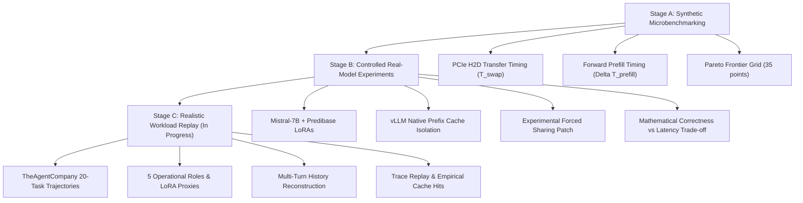

# Project Overview: The Locality Dilemma

**Course**: Carnegie Mellon University — 11-868: LLM Systems (Fall 2026)  
**Instructor**: Prof. Lei Li  
**Project**: *The Locality Dilemma: Dissecting Adapter Warmth vs. KV Prefix Reuse on Real Accelerators*  
**Repository**: [github.com/chengolivia/locality-dilemma](https://github.com/chengolivia/locality-dilemma)

---

## 1. Research Motivation & Core Dilemma

Modern Large Language Model (LLM) serving systems rely heavily on two complementary caching strategies to minimize inference latency and maximize accelerator throughput:

1. **KV Prefix Caching (Radix / Paged Attention Cache)**:
   Reuses precomputed Key-Value (KV) attention tensors for common prompt prefixes (e.g., system instructions, few-shot prompts, schemas, multi-turn conversation histories). Reusing cached prefixes avoids redundant forward-pass prefill compute, substantially lowering Time-To-First-Token (TTFT).

2. **LoRA Adapter Caching (Adapter Warmth)**:
   In multi-tenant systems serving hundreds of task-specific Low-Rank Adaptation (LoRA) adapters on a single shared base model, adapter weights must reside in GPU VRAM for zero-overhead execution. When an inactive adapter is requested, swapping its weights from host memory (CPU DRAM) over the PCIe bus introduces a non-trivial swap latency ($T_{\text{swap}}$).

### The Dilemma
High-bandwidth GPU memory (HBM/VRAM) is scarce. Schedulers face a fundamental memory locality competition:
- **Prioritize KV Prefix Cache (`prefix-first`)**: Retain large KV blocks in VRAM to maximize prompt prefix reuse. However, evicting inactive LoRA adapters forces PCIe weight swaps whenever requests switch domains or tasks.
- **Prioritize Adapter Warmth (`adapter-first`)**: Pin numerous LoRA adapter weights in VRAM to eliminate host-to-device weight transfer overheads. However, doing so restricts VRAM capacity available for KV cache, forcing prefill recomputation on prompt prefixes.

**Core Research Question**:  
*Where lies the Pareto frontier of adapter warmth versus KV prefix reuse on real hardware accelerators, and how do workload characteristics (prefix length, LoRA rank, multi-turn trajectory depth) govern optimal scheduling policy?*

---

## 2. Theoretical Framework & Cost Formulation

Let:
- $L$: Prefix length in tokens.
- $r$: LoRA rank dimension.
- $d$: Model hidden dimension ($d_{\text{model}} = 4096$ for Mistral-7B).
- $N_{\text{layers}}$: Number of transformer layers ($32$ for Mistral-7B).
- $M$: Number of adapted projection matrices per layer ($4$ for `q_proj`, `k_proj`, `v_proj`, `o_proj`).
- $P$: Precision in bytes per parameter (2 bytes for FP16/BF16).

### Adapter Swap Cost ($T_{\text{swap}}$)
The parameter count for an adapter of rank $r$ is:
$$\text{Parameters}(r) = 2 \times N_{\text{layers}} \times M \times d \times r$$
The raw memory footprint in bytes is:
$$\text{Size}(r) = \text{Parameters}(r) \times P$$
Over a PCIe link with effective bandwidth $\text{BW}_{\text{PCIe}}$, the weight transfer time is:
$$T_{\text{swap}}(r) = \frac{\text{Size}(r)}{\text{BW}_{\text{PCIe}}} + T_{\text{kernel\_launch}}$$

### Prefill Compute Savings ($\Delta T_{\text{prefill}}$)
For a cached prompt prefix of $L$ tokens, the forward prefill compute saved by KV reuse is:
$$\Delta T_{\text{prefill}}(L) = T_{\text{prefill}}(L) - T_{\text{prefill}}(0)$$
Because attention computation scales with sequence length (linearly with FlashAttention memory bandwidth constraints, and quadratically in computation), $\Delta T_{\text{prefill}}$ increases monotonically with $L$.

### Crossover & Policy Decision
The net latency delta is:
$$\Delta(L, r) = \Delta T_{\text{prefill}}(L) - T_{\text{swap}}(r)$$

- **$\Delta(L, r) > 0$ (`prefix-first`)**: Prefill compute saved exceeds adapter swap cost. The scheduler should prioritize retaining the KV prefix cache even if it requires reloading the adapter.
- **$\Delta(L, r) < 0$ (`adapter-first`)**: The adapter swap overhead exceeds the prefill compute savings. The scheduler should retain the warm adapter and recompute the short prefix.
- **$\Delta(L, r) = 0$ (Break-Even Frontier)**: The Pareto frontier where both strategies yield identical latency.

---

## 3. Investigation Roadmap

The project is structured into three experimental stages:

### Stage A: Synthetic Profiling (Completed)
- Measures isolated PCIe Host-to-Device transfer latency ($T_{\text{swap}}$) across ranks $r \in [8, 16, 32, 64, 128]$.
- Measures forward prefill compute latency ($\Delta T_{\text{prefill}}$) across context lengths $L \in [128, \dots, 8192]$.
- Maps the 35-point evaluation grid on Pittsburgh Supercomputing Center (PSC) NVIDIA H100 GPU hardware.

### Stage B: Controlled Real-Model vLLM Experiments (Completed)
- Real Mistral-7B-v0.1 base model and two real Predibase LoRA adapters (`magicoder`, `customer_support`) served with vLLM 0.33.0 on AWS EC2 (NVIDIA A10G 24GB).
- Evaluates native vLLM adapter-specific prefix caching against an experimental patched engine forcing cross-adapter KV reuse.
- Proves empirically and mathematically that while naive cross-adapter reuse cuts TTFT by ~33%, it corrupts inference states and generates hallucinated outputs.

### Stage C: Realistic Workload Replay (In Progress)
- Extracts 20 realistic enterprise agent tasks across 5 roles from TheAgentCompany trajectories.
- Reconstructs multi-turn event histories without forward leakage.
- Preflight verification and structural adapter checks completed; full-scale GPU replay and trace metrics collection in progress.
