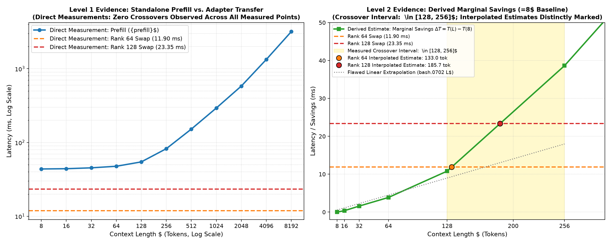

# Short-Context Crossover Analysis: Adapter Transfer vs. Prefill Compute on NVIDIA A10G

**Project**: The Locality Dilemma: Dissecting Adapter Warmth vs. KV Prefix Reuse on Real Accelerators  
**Hardware**: NVIDIA A10G Tensor Core GPU (AWS EC2 `g5.2xlarge`)  
**Scope**: LoRA Ranks $r \in [64, 128]$, Context Lengths $L \in [8, 16, 32, 64, 128, 256, 512, 1024, 2048, 4096, 8192]$  
**Date**: November 22, 2026 (Reviewed and Corrected)  
**Primary Dataset**: [`consolidated_crossover_analysis.csv`](consolidated_crossover_analysis.csv)

---

## 1. Executive Summary and Problem Formulation

In multi-LoRA serving systems, scheduling policies face a trade-off known as the **Locality Dilemma**:
- **Prefix Locality (Prefix-First)**: Keep the KV cache of a shared prompt prefix warm on the GPU, avoiding recomputing the prefix, but pay the PCIe transfer latency ($T_{\text{swap}}$) to load the required LoRA adapter weights if they are not resident on the accelerator.
- **Adapter Locality (Adapter-First)**: Keep the LoRA adapter weights resident on the accelerator, but pay the forward compute latency to recompute the prompt prefix if its KV cache was evicted.

Our initial A10G synthetic sweep ($L \in [128, 8192]$) observed that prefill compute was 3.8x to 8.1x slower on the A10G than on the H100, whereas adapter transfer was only ~1.7x to 2.0x slower. Consequently, total prefill latency exceeded adapter transfer latency at every measured point.

This report validates the follow-up short-context benchmark ($L \in [8, 16, 32, 64]$) integrated with the complete A10G dataset ($L \in [8, 8192]$), distinguishes three distinct levels of evidence, and ensures interpolated estimates are clearly differentiated from measured data.

---

## 2. Three Levels of Evidence

To maintain rigorous scientific clarity, the findings of this study must be categorized into three distinct levels of evidence:

```
┌────────────────────────────────────────────────────────────────────────────────────────┐
│ LEVEL 1: DIRECT MEASUREMENTS (Empirical Observations)                                  │
│  • Standalone forward prefill latency T_prefill(L) for L in [8, 8192] (batch size 1).   │
│  • Adapter transfer latency T_swap for ranks 64 (11.90 ms) and 128 (23.35 ms).          │
│  • Direct Finding: T_prefill > T_swap at EVERY measured point (8 <= L <= 8192).         │
│  • Zero crossovers were directly observed under the standalone benchmark definition.   │
├────────────────────────────────────────────────────────────────────────────────────────┤
│ LEVEL 2: DERIVED ESTIMATES (Mathematical Formulations & Interpolations)               │
│  • Marginal prefill savings: ΔT_marginal(L) = T(L) - T(8).                             │
│  • Empirical crossover interval: strictly bounded within [128, 256] tokens.            │
│  • Interpolated crossover estimates: ~133.0 tokens (rank 64) and ~185.7 tokens (r128). │
│  • Status: Mathematical estimates based on linear interpolation, NOT measured points. │
├────────────────────────────────────────────────────────────────────────────────────────┤
│ LEVEL 3: NOT YET MEASURED (Realistic Serving Workloads & Open Questions)              │
│  • True KV-cache savings vs. adapter-switch costs in multi-tenant serving engines.     │
│  • Concurrent continuous batching, chunked prefill, and suffix-on-prefix execution.   │
│  • Asynchronous adapter transfer pipelining overlapping on secondary CUDA streams.     │
│  • KV cache eviction policies and VRAM fragmentation under multi-adapter co-location.  │
└────────────────────────────────────────────────────────────────────────────────────────┘
```

### Level 1: Direct Measurements
- **Standalone Prefill Latency ($T_{\text{prefill}}$)**: Directly measured using `torch.cuda.Event` for isolated sequences of length $L \in [8, 16, 32, 64, 128, 256, 512, 1024, 2048, 4096, 8192]$ on Mistral-7B ($B=1$, FP16, empty KV cache). At every measured length, $T_{\text{prefill}} \ge 43.77\text{ ms}$.
- **Adapter Transfer Latency ($T_{\text{swap}}$)**: Directly measured over PCIe Gen4 x8 for LoRA ranks $r \in [8, 16, 32, 64, 128]$ ($11.90\text{ ms}$ for rank 64, $23.35\text{ ms}$ for rank 128).
- **Direct Empirical Finding**: Under the benchmark's native standalone prefill definition ($\Delta_{\text{raw}} = T_{\text{prefill}} - T_{\text{swap}}$), $T_{\text{prefill}} > T_{\text{swap}}$ for all 11 directly measured context lengths ($8 \le L \le 8192$). **No crossover was directly measured on the A10G.**

### Level 2: Derived Estimates
- **Marginal Standalone-Prefill Savings**: Numerically derived by subtracting the empirical baseline floor ($L=8$, $43.77\text{ ms}$) from standalone prefill latency ($\Delta T_{\text{marginal}}(L) = T_{\text{prefill}}(L) - T_{\text{prefill}}(8)$).
- **Measured Crossover Interval**: The derived marginal prefill savings crosses the adapter swap latency strictly within the **measured interval $L \in [128, 256]$ tokens** ($10.81\text{ ms} < T_{\text{swap}} < 38.64\text{ ms}$).
- **Interpolated Crossover Estimates**: Linear interpolation across the $[128, 256]$ interval yields estimated crossover points at **$\approx 133.0\text{ tokens}$ for Rank 64** and **$\approx 185.7\text{ tokens}$ for Rank 128**.
- *Important Labeling Distinction*: These numbers (133.0 and 185.7 tokens) are **mathematical interpolation estimates**, NOT experimentally observed data points.

### Level 3: Not Yet Measured (Realistic Serving Workloads)
- **Actual KV-Cache Savings vs. Adapter-Switch Costs in Realistic Serving**:
  - The benchmark does not measure true multi-request prefix-suffix sharing (where a shared prefix is reused and only an uncached suffix is computed in an ongoing generation context).
  - Does not measure concurrent multi-tenant serving (continuous batching, chunked prefill, inter-request scheduling).
  - Does not measure asynchronous adapter transfer pipelining (overlapping DMA weight transfers with ongoing GPU decode execution on secondary CUDA streams).
  - Does not measure memory fragmentation, KV eviction dynamics, or multi-adapter VRAM co-location overheads.

---

## 3. Measurement Definitions and Methodology

### 3.1 Prefill Compute Latency ($T_{\text{prefill}}$)
- **What is actually measured**: In `scripts/synthetic/benchmark_prefill_latency.py`, the harness executes `model(input_ids, use_cache=True)` where `input_ids` has shape `(1, L)` and `past_key_values` is `None`.
- **Nature of the measurement**: This is a **cold-cache forward pass of an entire sequence of length $L$**. It measures the total time required for all 32 transformer layers of Mistral-7B (float16) to execute projections, layer norms, attention, and MLPs, allocating and populating KV cache tensors for those $L$ tokens.
- **What it is NOT**: It is **not** an incremental forward pass processing an uncached suffix attached to an existing cached prefix.
- **Zero-prefix baseline**: There is no zero-token prompt baseline in the benchmark (an LLM cannot execute a forward pass on 0 input tokens). The lowest context length directly measured on the A10G is $L=8$ tokens.

### 3.2 Adapter Transfer Latency ($T_{\text{swap}}$)
- **What is actually measured**: In `scripts/synthetic/benchmark_lora_transfer.py`, the harness transfers pinned CPU host tensors representing LoRA adapter weights (4 projections per layer $\times$ 32 layers = 128 weight tensors) to the GPU using asynchronous non-blocking memory copies (`.to(device='cuda', non_blocking=True)`), timed with `torch.cuda.Event`.
- **Values for tested ranks**:
  - **Rank 64** (128.0 MB): Median = **11.897 ms** (Effective PCIe Bandwidth = 11.28 GB/s).
  - **Rank 128** (256.0 MB): Median = **23.352 ms** (Effective PCIe Bandwidth = 11.50 GB/s).

### 3.3 Comparability and Assumptions
- Both benchmarks use `torch.cuda.Event(enable_timing=True)` on the primary CUDA stream with 10 untimed warmup iterations and repeated timed iterations (100 for transfer, 50 for prefill).
- Comparing prefill latency directly with adapter transfer latency assumes:
  1. **Strictly Sequential Execution**: Adapter transfer is assumed to lie entirely on the critical path of the request. (In a production engine like vLLM, adapter transfers on secondary CUDA streams may partially or completely overlap with ongoing decode iterations of other requests).
  2. **Isolated Single-Stream Operation**: Batch size is 1, with no concurrent PCIe traffic, no background token streaming, and no KV cache memory fragmentation.

---

## 4. Dissecting the Operations: Standalone vs. Suffix vs. Transfer

To prevent confusion, three fundamentally distinct operations must be distinguished:

1. **Recomputing a Standalone Prefix ($T_{\text{prefill}}(L_{\text{prefix}})$)**:
   - If an entire prompt consists of a prefix of length $L$, or if a prefix is prefilled as a standalone execution block, recomputing it requires executing a full forward pass of length $L$.
   - On the A10G, executing all 32 layers of Mistral-7B incurs sequential PyTorch kernel launches (hundreds of individual CUDA kernel dispatches for LayerNorms, QKV/O GEMMs, RoPE, SDPA, and SwiGLU MLPs) plus weight memory traffic. Even at $L=8$, this total forward pass takes **43.77 ms**.
   - **Caching this standalone prefix eliminates the entire 43.77 ms forward pass.**
2. **Processing an Uncached Suffix on a Cached Prefix ($T_{\text{suffix}}(L_{\text{suffix}} \mid L_{\text{prefix}})$)**:
   - In realistic chat or instruction serving, a request has an $L_{\text{prefix}}$-token prefix (e.g. system instructions) followed by an $L_{\text{suffix}}$-token query.
   - If the prefix is cached, the model must still execute a forward pass for the $L_{\text{suffix}}$ query tokens, referencing the cached KV tensors.
   - If the prefix is not cached, the model executes a forward pass for all $L_{\text{prefix}} + L_{\text{suffix}}$ tokens.
   - The compute time saved by caching the prefix in this scenario is the **marginal difference**:
     $$\text{Savings}_{\text{marginal}} = T_{\text{prefill}}(L_{\text{prefix}} + L_{\text{suffix}}) - T_{\text{prefill}}(L_{\text{suffix}} \mid \text{cached prefix})$$
   - *Important*: The synthetic benchmark script did not measure combined prefix-suffix requests; it measured standalone sequences of length $L$.
3. **Transferring an Adapter ($T_{\text{swap}}$)**:
   - Transferring weight tensors over the PCIe bus is an interconnect operation governed by PCIe link bandwidth and DMA initialization, not GPU arithmetic execution.

---

## 5. Quantitative Results: Complete A10G Dataset

The table below integrates the short-context sweep ($L \in [8, 64]$) with the primary A10G benchmark ($L \in [128, 8192]$) across ranks 64 and 128:

| Context ($L$) | LoRA Rank | Adapter Size | Measured Prefill ($T_{\text{prefill}}$) | Adapter Swap ($T_{\text{swap}}$) | Raw Delta ($T_{\text{prefill}} - T_{\text{swap}}$) | Raw Status (Level 1) | Marginal Savings ($T(L) - T(8)$) | Marginal Delta ($\text{Marginal} - T_{\text{swap}}$) | Marginal Status (Level 2) |
|:---:|:---:|:---:|:---:|:---:|:---:|:---:|:---:|:---:|:---:|
| **8** | 64 | 128 MB | 43.766 ms | 11.897 ms | **+31.869 ms** | Above (Prefix-First) | 0.000 ms | **-11.897 ms** | Below (Adapter-First) |
| **8** | 128 | 256 MB | 43.766 ms | 23.352 ms | **+20.414 ms** | Above (Prefix-First) | 0.000 ms | **-23.352 ms** | Below (Adapter-First) |
| **16** | 64 | 128 MB | 44.138 ms | 11.897 ms | **+32.242 ms** | Above (Prefix-First) | 0.372 ms | **-11.525 ms** | Below (Adapter-First) |
| **16** | 128 | 256 MB | 44.138 ms | 23.352 ms | **+20.787 ms** | Above (Prefix-First) | 0.372 ms | **-22.980 ms** | Below (Adapter-First) |
| **32** | 64 | 128 MB | 45.345 ms | 11.897 ms | **+33.448 ms** | Above (Prefix-First) | 1.579 ms | **-10.318 ms** | Below (Adapter-First) |
| **32** | 128 | 256 MB | 45.345 ms | 23.352 ms | **+21.993 ms** | Above (Prefix-First) | 1.579 ms | **-21.773 ms** | Below (Adapter-First) |
| **64** | 64 | 128 MB | 47.627 ms | 11.897 ms | **+35.730 ms** | Above (Prefix-First) | 3.861 ms | **-8.036 ms** | Below (Adapter-First) |
| **64** | 128 | 256 MB | 47.627 ms | 23.352 ms | **+24.275 ms** | Above (Prefix-First) | 3.861 ms | **-19.491 ms** | Below (Adapter-First) |
| **128** | 64 | 128 MB | 54.573 ms | 11.897 ms | **+42.676 ms** | Above (Prefix-First) | 10.807 ms | **-1.090 ms** | Below (Adapter-First) |
| **128** | 128 | 256 MB | 54.573 ms | 23.352 ms | **+31.221 ms** | Above (Prefix-First) | 10.807 ms | **-12.545 ms** | Below (Adapter-First) |
| **256** | 64 | 128 MB | 82.402 ms | 11.897 ms | **+70.505 ms** | Above (Prefix-First) | 38.636 ms | **+26.739 ms** | **Above (Prefix-First)** |
| **256** | 128 | 256 MB | 82.402 ms | 23.352 ms | **+59.050 ms** | Above (Prefix-First) | 38.636 ms | **+15.284 ms** | **Above (Prefix-First)** |
| **512** | 64 | 128 MB | 151.887 ms | 11.897 ms | **+139.990 ms** | Above (Prefix-First) | 108.121 ms | **+96.224 ms** | Above (Prefix-First) |
| **512** | 128 | 256 MB | 151.887 ms | 23.352 ms | **+128.535 ms** | Above (Prefix-First) | 108.121 ms | **+84.769 ms** | Above (Prefix-First) |
| **1024** | 64 | 128 MB | 293.313 ms | 11.897 ms | **+281.416 ms** | Above (Prefix-First) | 249.546 ms | **+237.649 ms** | Above (Prefix-First) |
| **1024** | 128 | 256 MB | 293.313 ms | 23.352 ms | **+269.961 ms** | Above (Prefix-First) | 249.546 ms | **+226.194 ms** | Above (Prefix-First) |
| **2048** | 64 | 128 MB | 582.034 ms | 11.897 ms | **+570.138 ms** | Above (Prefix-First) | 538.268 ms | **+526.371 ms** | Above (Prefix-First) |
| **2048** | 128 | 256 MB | 582.034 ms | 23.352 ms | **+558.683 ms** | Above (Prefix-First) | 538.268 ms | **+514.916 ms** | Above (Prefix-First) |
| **4096** | 64 | 128 MB | 1336.286 ms | 11.897 ms | **+1324.389 ms** | Above (Prefix-First) | 1292.520 ms | **+1280.623 ms** | Above (Prefix-First) |
| **4096** | 128 | 256 MB | 1336.286 ms | 23.352 ms | **+1312.934 ms** | Above (Prefix-First) | 1292.520 ms | **+1269.168 ms** | Above (Prefix-First) |
| **8192** | 64 | 128 MB | 3187.124 ms | 11.897 ms | **+3175.227 ms** | Above (Prefix-First) | 3143.357 ms | **+3131.461 ms** | Above (Prefix-First) |
| **8192** | 128 | 256 MB | 3187.124 ms | 23.352 ms | **+3163.772 ms** | Above (Prefix-First) | 3143.357 ms | **+3120.006 ms** | Above (Prefix-First) |

---

## 6. Visual Trade-Off Analysis

The plot below displays both the directly measured standalone prefill and the derived marginal prefill calculations across context lengths:



- **Panel A (Direct Measurements, Log-Log Scale)**: Compares measured standalone forward prefill compute against adapter transfer latency across all 11 context lengths. At every measured point ($L \in [8, 8192]$), raw prefill is strictly higher than adapter transfer.
- **Panel B (Derived Estimates, Linear Scale, $L \le 300$)**: Compares marginal prefill compute relative to the $L=8$ baseline against adapter transfer latency. The measured crossover interval $[128, 256]$ is highlighted in yellow, and the linear interpolated estimates are marked at **133.0 tokens (Rank 64)** and **185.7 tokens (Rank 128)**, explicitly labeled as *interpolated estimates*.

---

## 7. Corrections to Prior Interpretations

1. **Clarification of the ~43 ms Latency Baseline**:
   - The ~43.1–43.8 ms forward latency observed at $L \le 8$ tokens represents un-compiled PyTorch eager-mode execution overhead on this specific software environment. It is driven by sequential CPU-GPU kernel dispatch across 32 layers (LayerNorms, QKV/O GEMMs, RoPE, SDPA, SwiGLU) and activation memory traffic.
   - It is **not** an "immutable hardware execution floor" of the A10G accelerator silicon. Highly optimized runtimes (such as vLLM utilizing CUDA Graphs and kernel fusion) can reduce dispatch overhead.
   - It should **not** be attributed to host-to-device PCIe bandwidth; memory access during model execution occurs across the GPU's internal GDDR6 memory bus (~600 GB/s), not the PCIe bus.
2. **Clarification of Crossover Status**:
   - Under Level 1 direct measurements ($\Delta_{\text{raw}} = T_{\text{prefill}} - T_{\text{swap}}$), **no crossover exists**; prefix-first wins for every single measured configuration.
   - Under Level 2 derived marginal savings relative to $L=8$ ($\Delta T = T(L) - T(8)$), a crossover occurs strictly within the **measured interval $L \in [128, 256]$ tokens**.
   - Interpolated estimates are $\approx 133.0$ tokens (Rank 64) and $\approx 185.7$ tokens (Rank 128). Prior estimates of 169 and 333 tokens were artifacts of an invalid linear extrapolation over 8–64 tokens.

---

## 8. Artifact Manifest

- **Consolidated Crossover Dataset (CSV)**: [`consolidated_crossover_analysis.csv`](consolidated_crossover_analysis.csv)
- **Combined Analysis Table (CSV)**: [`crossover_combined.csv`](crossover_combined.csv)
- **Dual-Perspective Visualization (PNG)**: [`crossover_analysis_plot.png`](crossover_analysis_plot.png)
- **Short-Context Prefill Measurements (CSV)**: [`prefill.csv`](prefill.csv)
- **Filtered Swap Measurements (CSV)**: [`swap.csv`](swap.csv)
- **Paired Timings (CSV)**: [`timings.csv`](timings.csv)
- **Standard Pipeline Summary (CSV)**: [`analysis/summary.csv`](analysis/summary.csv)
- **Execution Log**: [`benchmark_run.log`](benchmark_run.log)
